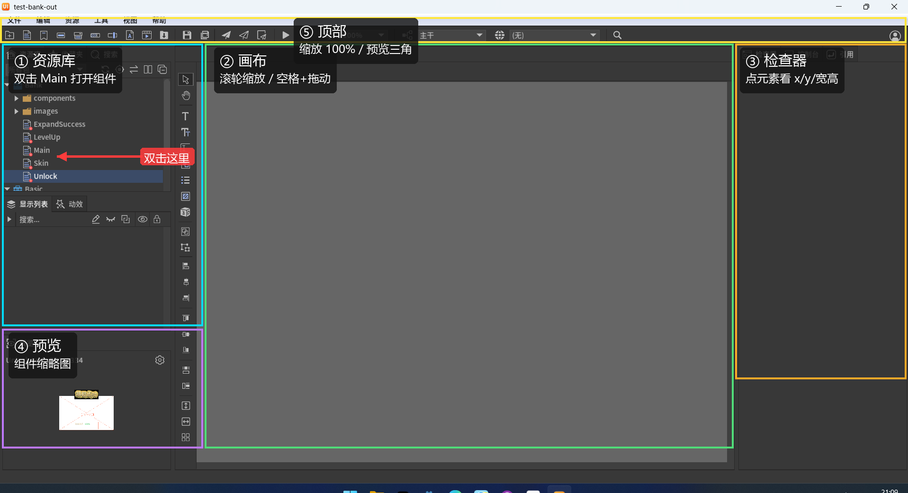

# FairyGUI Editor 速查（先当查看器用）

> 你不需要学整个软件。现在只需要会三件事：**双击打开组件、点元素看属性、截图**。
> 发布、控制器、动效、代码，全部先不碰。

## 五个区域

| 区域 | 在哪 | 干什么 |
|---|---|---|
| ① 资源库 | 左上 | 展开包 → 双击组件（如 `Main`）打开 |
| ② 画布 | 中间 | 打开后显示页面；滚轮缩放，空格+拖动平移 |
| ③ 检查器 | 右侧 | 点中元素后看 `x / y / 宽 / 高 / 图片 / 文本` |
| ④ 预览 | 左下 | 组件缩略图；不是完整画布 |
| ⑤ 顶部 | 最上面 | 缩放（100%）、预览三角、包/组件下拉 |

## 打开一个组件（3 步）

1. 左上资源库 → 展开 `Bank`。
2. **双击** `Main`（不是单击；单击只会选中）。
3. 中间画布出现 750×1334 的页面。

如果只看到局部：顶部 `100%` 改成 `50%`，或把鼠标放画布上滚轮缩小；按住空格拖动平移。

## 看一个元素

- 点画布里的按钮/图片 → 右侧检查器显示位置、尺寸、图片名。
- 左下「显示列表」看层级：`frame` / `btnClose` / `imgArrow1` 这些名字就是代码里的节点名。
- 想看整体：点顶部三角「预览」，或左下预览区。

## 为什么现在很多空白

- `Bank` 自己只有 8 张图；`Main` / `Unlock` 大量节点引用 `Basic / Basic2 / Basic3`，这些依赖包还原时是空壳。
- 所以现在能看的是**结构、坐标、命名**，不是完整画面。
- 想先看有图的：打开 `test-items-out.fairy`，双击 `chooseGift/Select`。

## 文字乱码

例如 `閫夋嫨濂栧姳` 其实是「选择奖励」。这是还原工具的 GBK/UTF-8 编码问题，图和布局不受影响；后面可以统一修 XML。

## 现在别碰

- 发布（文件 → 发布）
- 控制器 / Gear / 动效
- 代码/扩展

## 以后要给 Godot 用

在 Editor 里改完 → 「文件 → 发布」→ 输出 `.fui` + 图集 → Godot 用 FairyGUI-godot 运行时加载。
这一步等结构和素材确认后再做。
